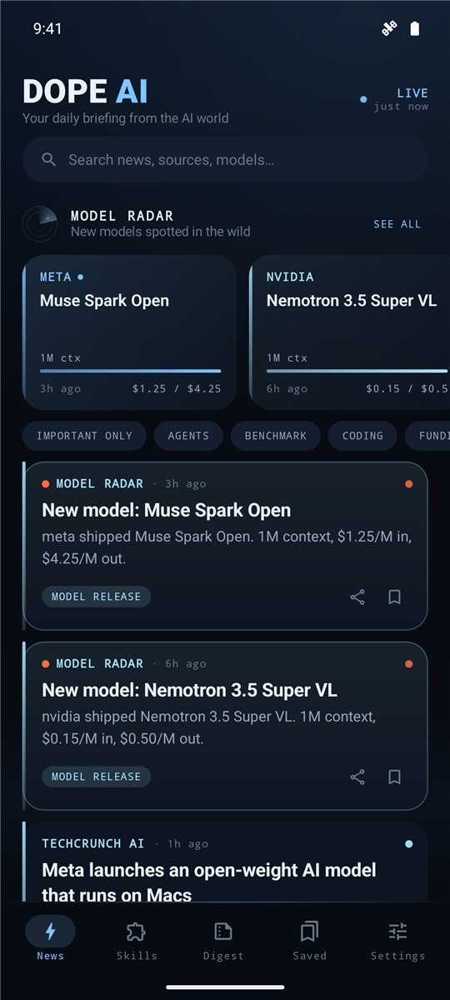
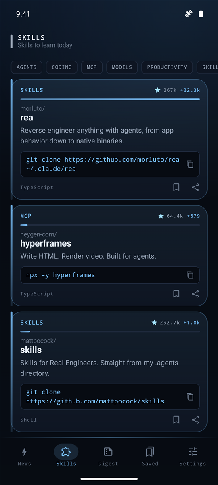
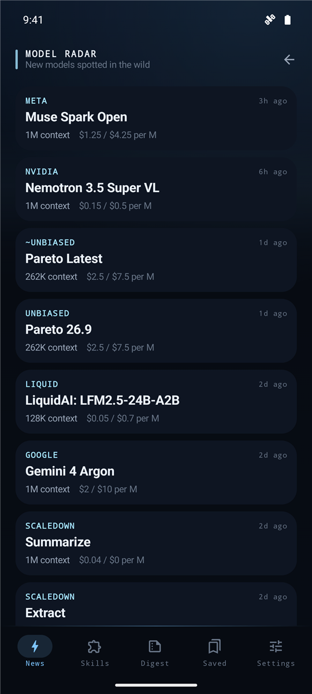

<h1 align="center">Dope AI</h1>

<b>Stay current on AI in two minutes a day.</b> 
Model releases, agent tooling, the developer skills blowing up on GitHub, and one daily digest. Refreshed every hour.

  <a href="https://github.com/Dor-Sloim/dope-ai-app/releases/latest/download/dope-ai.apk"><b>⬇ Download for Android</b></a>
  &nbsp;·&nbsp;
  <a href="https://github.com/Dor-Sloim/dope-ai-app/releases">What's new</a>

  
  
  

## Why you'll like it

- **News that matters, ranked.** 20+ sources (AI labs, Hacker News, TechCrunch, The Verge and more), deduplicated, with the big stories on top.
- **Model Radar.** Every new model the moment it shows up, with context size and price.
- **Skills to learn today.** The repos developers are starring fastest right now, with a copy-ready install command.
- **Push alerts, only for the big ones.** Breaking stories and repos exploding on GitHub, never at night.
- **Read without leaving.** Articles open inside the app. Save anything for later.

## Install

1. On your Android phone, tap **[Download Dope AI](https://github.com/Dor-Sloim/dope-ai-app/releases/latest/download/dope-ai.apk)**.
2. Open the downloaded file. If Android asks, allow your browser to install apps, then tap **Install**.
3. If Google Play Protect warns about an unknown app, tap **More details → Install anyway**.
   The app is not on Google Play, so Play Protect has not seen it before.

Requires Android 8.0 or newer.

## Updates

When a new version is out, the app tells you what changed and shows an **Update** button.
Tap it, then tap **Update** in the Android installer. Your saved items and settings stay.

The first time only, Android asks you to allow Dope AI to install apps. Allow it, go back, and tap **Update** again.

Every version and what changed in it: [Releases](https://github.com/Dor-Sloim/dope-ai-app/releases).

## Privacy

No account and no third-party analytics. Saved items stay on your phone.
To count installs, the app sends a random ID it creates on first start, plus its version and language. The ID is not linked to you, your phone or your Google account.
Notifications are delivered through Firebase Cloud Messaging.

This repository holds release builds only.
